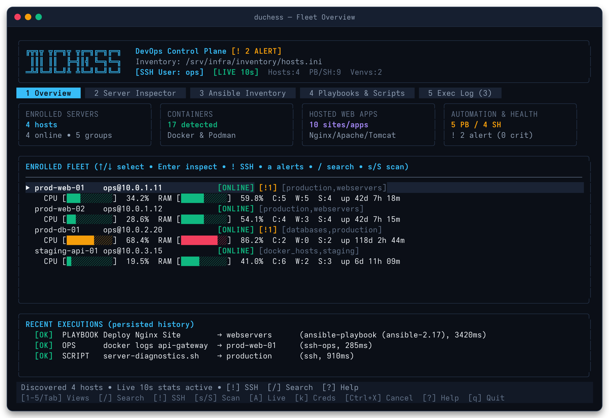
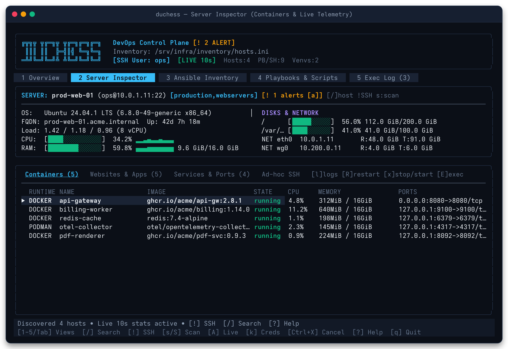
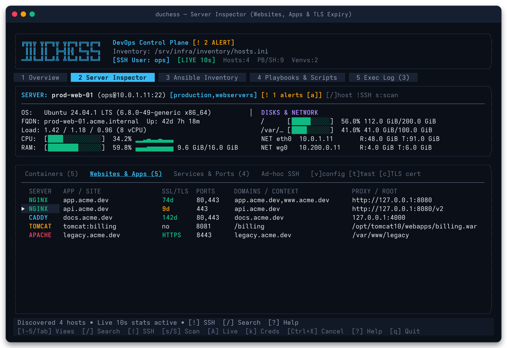
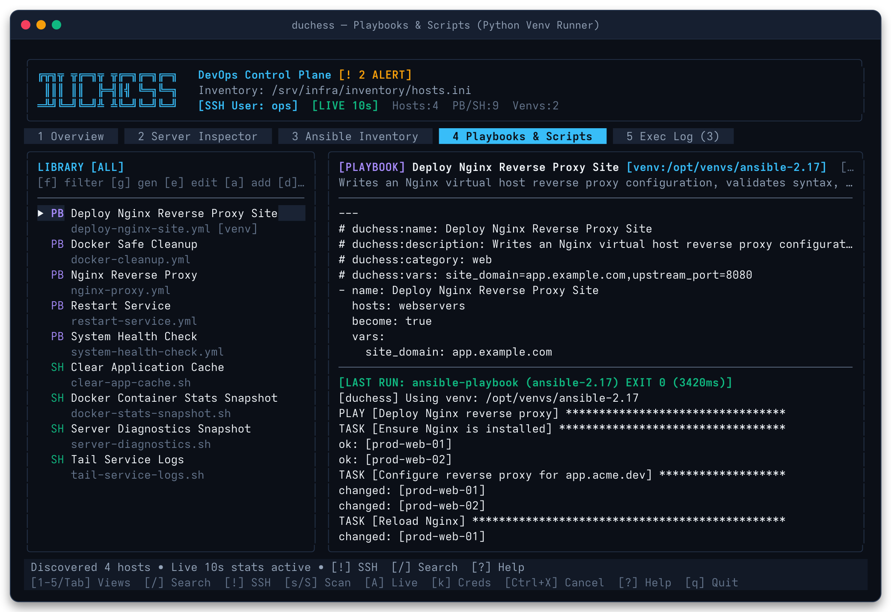
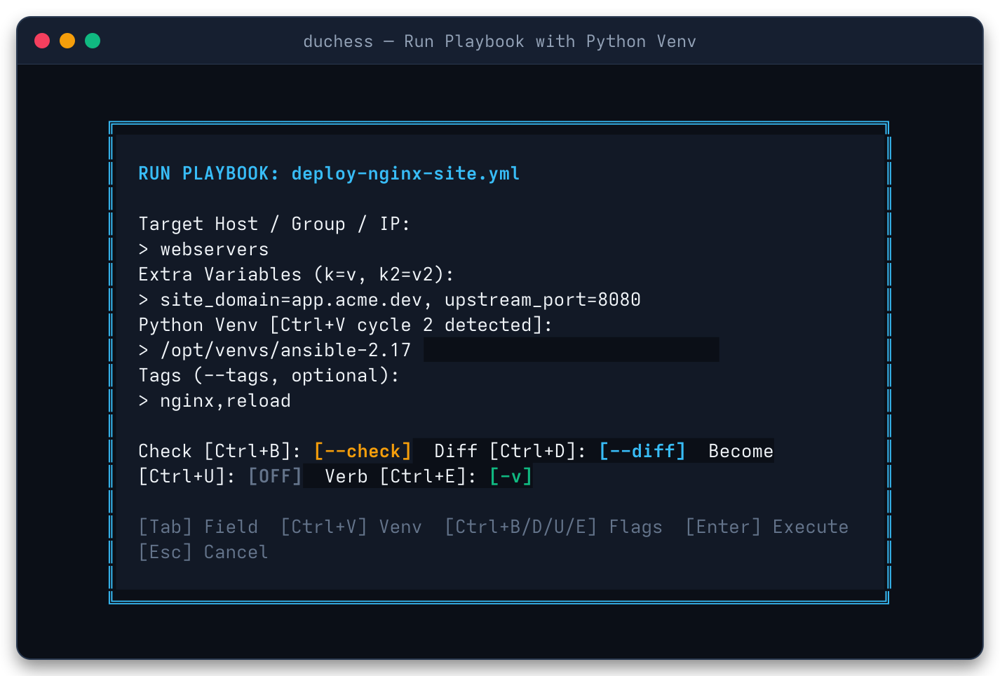

# Duchess — DevOps TUI & CLI Control Plane

Duchess is a Go-based DevOps TUI dashboard and CLI for managing servers over SSH, inspecting live telemetry & proactive health alerts, auto-detecting containers/services/web apps/TLS certs, enrolling hosts via Ansible inventories, and running Ansible playbooks (with Python `venv` isolation) and shell scripts with live streaming output.

---

## Screenshots

### Fleet Overview & Proactive Health Alerts


### Server Inspector — Live Telemetry & Actionable Containers


### Auto-Detected Websites, Reverse Proxies & TLS Expiry


### Playbooks & Scripts with Python Virtualenv (`--venv`) Execution




---

## Project Layout

```text
duchess/
├── inventory/
│   ├── hosts.ini               # Ansible INI inventory
│   └── hosts.yml               # Ansible YAML inventory
├── playbooks/                  # Ansible playbooks (.yml)
├── scripts/                    # SSH shell scripts (.sh)
├── duchess.yml                 # Optional workspace config (venv, SSH, alerts, polling)
└── cli/                        # Duchess Go TUI & CLI
```

---

## Quick Start

Build the binary:

```bash
cd cli
go build -o bin/duchess .
```

### Interactive ASCII TUI Dashboard (Default)

```bash
./bin/duchess
# or pass SSH user/key/jump/venv directly to skip the launch prompt:
./bin/duchess -u ubuntu -k ~/.ssh/id_ed25519 -J bastion.internal --venv ~/venvs/ansible
```

**TUI Views & Keybindings:**
- **`1` Overview**: ASCII fleet dashboard with KPI cards, proactive alert badges (`!N`), enrolled servers, live CPU/RAM gauges (`[█████░░░░░]`), fuzzy search (`/`), interactive SSH (`!`), host alerts (`a`), and recent persisted executions.
- **`2` Server Inspector**: Live OS/kernel/load/uptime stats, ASCII bar meters + sparkline trends (`▁▂▃▄▅▆▇█`), TLS cert expiry, and 4 actionable sub-tabs (`←`/`→`):
  - **Containers**: `l` tail logs • `R` restart • `x` stop/start • `E` interactive `docker exec -it` shell
  - **Websites & Apps** (Nginx/Apache/Tomcat/Caddy/HAProxy/HTTP): `v` view raw config • `t` test config (`nginx -t` / `apachectl configtest`) • `c` inspect TLS cert
  - **Services & Ports**: `l` `journalctl -u` logs • `R` restart • `o` reload
  - **Ad-hoc SSH Console**: live streaming output with `Ctrl+G` multi-host fan-out scope (`Host` / `Group` / `All`)
- **`3` Ansible Inventory**: Enroll hosts (`a`), import INI/YAML (`i`), edit in `$EDITOR` (`e`), view raw INI (`v`), delete (`d`), interactive SSH (`!`), or scan (`s`).
- **`4` Playbooks & Scripts**: Browse/filter (`f`), search (`/`), edit in `$EDITOR` (`e`), run with **Python `venv` selector (`Ctrl+V`)**, `--check` (`Ctrl+B`), `--diff` (`Ctrl+D`), `--become` (`Ctrl+U`), `-v` verbosity (`Ctrl+E`), `--tags`, live streaming output, and `Ctrl+X` cancellation; Generator Wizard (`g`); import/add (`a`).
- **`5` Execution Log**: Persistent cross-session audit history (`.duchess/history/executions.jsonl`) with filter (`f`: all/failed/playbook/script/ops/ssh) and search (`/`).
- **Global**: `/` search • `!` interactive TTY SSH • `s`/`S` scan • `A` toggle auto-refresh • `k` SSH creds & ProxyJump • `Ctrl+X` cancel running job • `r` reload workspace • `?` help • `q` quit.

---

## Python Virtualenv (`--venv`) Support for Playbooks

Duchess resolves the controller Python virtualenv in priority order:

1. Explicit `--venv /path/to/venv` flag (or TUI Run modal **Python Venv** field, `Ctrl+V` cycles detected venvs)
2. Playbook header metadata: `# duchess:venv: /path/to/venv`
3. Workspace config (`ansible_venv:` in `duchess.yml` or `DUCHESS_ANSIBLE_VENV` env var)
4. Active `$VIRTUAL_ENV` or auto-detected `<workspace>/.venv` / `<workspace>/venv`

When an explicit/configured venv is specified and does not contain `bin/ansible-playbook`, Duchess fails fast with a clear error rather than silently falling back. You can also target a remote host virtualenv via `--remote-venv /srv/app/.venv` (or `# duchess:remote_venv:`), which injects `-e ansible_python_interpreter=/srv/app/.venv/bin/python`.

```bash
# Discover available Ansible virtualenvs and versions
./bin/duchess playbook venvs

# Run a playbook using a specific controller venv + diff/check/tags
./bin/duchess playbook run deploy-nginx-site.yml --venv ~/venvs/ansible-2.17 --limit webservers --check --diff --tags nginx -vv

# Pin a remote Python interpreter venv
./bin/duchess playbook run app-migrate.yml --venv ./.venv --remote-venv /opt/app/.venv
```

---

## Scriptable Subcommands

```bash
# Inventory management
./bin/duchess inventory list
./bin/duchess inventory import /path/to/other-hosts.ini
./bin/duchess inventory add app-02 --host 10.0.1.25 --ssh-user ubuntu --group production,webservers

# Live stats, watch, and full discovery (including TLS expiry & health alerts)
./bin/duchess stats all
./bin/duchess watch prod-app-01 --interval 5
./bin/duchess discover all --json

# Playbooks, scripts, ad-hoc exec, file transfer, interactive SSH, and audit history
./bin/duchess playbook list
./bin/duchess playbook venvs
./bin/duchess playbook run system-health-check.yml --venv ~/.venvs/ansible --limit prod-app-01
./bin/duchess script run server-diagnostics.sh --target webservers
./bin/duchess exec webservers "systemctl is-active nginx"
./bin/duchess cp ./nginx.conf webservers:/etc/nginx/conf.d/app.conf
./bin/duchess cp prod-app-01:/var/log/nginx/error.log ./error.log
./bin/duchess ssh prod-app-01
./bin/duchess history --failed --limit 20
```

---

## Optional Workspace Config (`duchess.yml`)

Place a `duchess.yml` in your workspace root (or `~/.config/duchess/config.yml`):

```yaml
inventory: inventory/hosts.ini
ansible_venv: ~/venvs/ansible
remote_venv: /opt/app/.venv
poll_interval_seconds: 10
exec_timeout_seconds: 0 # 0 = unlimited
ssh:
  user: ubuntu
  jump_host: bastion.internal
  use_ssh_config: true
  strict_host_key: false
alerts:
  disk_warn_pct: 85
  disk_crit_pct: 95
  mem_warn_pct: 90
  cpu_warn_pct: 90
  load_factor: 1.5
  cert_warn_days: 14
```

## Production SSH Features

- **`~/.ssh/config` integration**: Automatically resolves `HostName`, `User`, `Port`, `IdentityFile`, and `ProxyJump`.
- **Bastion / `ProxyJump`**: Pass `-J user@bastion:22`, set `ssh.jump_host` in `duchess.yml`, set `proxy_jump` / `ansible_ssh_common_args='-J ...'` in inventory, or configure in `~/.ssh/config`.
- **Host key verification**: Pass `--strict-host-key` (or `ssh.strict_host_key: true`) to verify against `~/.ssh/known_hosts`.
- **Passphrase-protected keys**: Supports `ssh-agent` or `DUCHESS_SSH_KEY_PASSPHRASE` with clear diagnostics if a key requires a passphrase.
- **SSH credential forwarding**: Session user, port, private key, and jump host are automatically forwarded to `ansible-playbook`.
